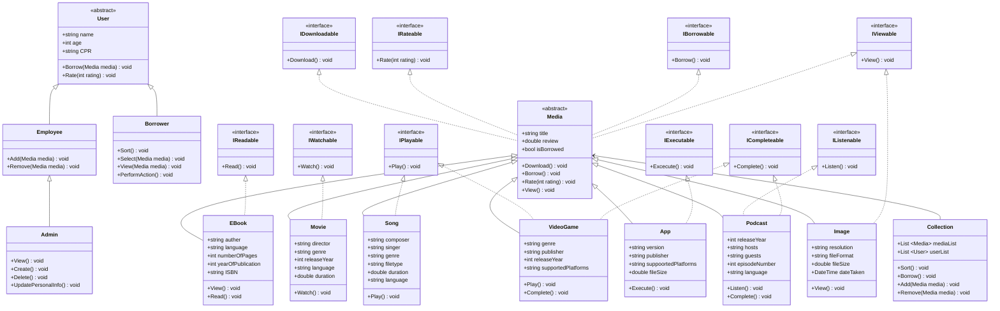

# oop-workshop
OOP Projekt 1. semester (Øvelsesprojekt)

### Krav

### Funktionelle krav
#### Indhold
Programmet skal understøtte
- E-Books
- Movies
- Songs
- Video-games
- Apps
- Podcasts
- Images

For hver type skal programmet gemme metadata

#### Udlån
Brugere skal kunne låne alle typer af medie i biblioteket
Brugere som har lånt mediet skal kunne give en bedømmelse

#### Brugere
Der skal forskellige typer af brugere
- Borrower
- Employee
- Admin
Ved opstart skal programmet bede om at man angiver hvilken bruger man er
Programmet skal gemme oplysninger om navn, alder, cpr nummer. 

I første omgang er verificering ikke nødvendigt, men programmet skal bare spørge om hvilken brugertype personen er.

Borrower:
Skal kunne interergere med samlingen af medier ved at liste items efter type, vælge og se detaljer om item, rate item og udføre de aktioner som høre til det medie de vælger

Employee:
Skal kunne administrere samlingen ved at tilføje eller fjerne medie

Admin:
Skal have alle rettigheder som employee, men kan også manage, borrowers og emplyees. Manegement dækker viewing, creating, deleting og updating personlig information om brugere

### Ikke funktionelle krav

Systemet skal designes så det kan udvides med nye medietyper og lign uden stort besvær

Ugyldige handlinger må ikke kunne crashe programmet

Det skal være konsolbaseret der guider brugeren tydeligt

### 2. Verb noun analyse af programspecifikation

| Navneord                                                                                                 | Udsagnsord                                                                                                                      |
| -------------------------------------------------------------------------------------------------------- | ------------------------------------------------------------------------------------------------------------------------------- |
| **E-books**  Title Author Language Number of pages Year of publication ISBN   | View Download Read                                                                                                        |
| **Movies**  Title Director Genres Release year Language Duration                    | Watch Download                                                                                                               |
| **Songs**  Title Composer Singer Genre File type Duration Language               | Play download                                                                                                                |
| **Video-games**  Title Genre Publisher Release year Supported platforms                | Download Play Complete                                                                                                    |
| **Apps**  Title Version Publisher Supported platforms File Size                     | Download Execute                                                                                                             |
| **Podcasts**  Title Release year Hosts Guests Episode number Language               | Download Listen Complete                                                                                                  |
| **Images**  Title Resolution File format File Size Date taken                          | Download Display                                                                                                          |
| **Users**  Name Age CPR                                                                   | Borrow  **If borrowed:** Rate item                                                                                     |
| **Borrower**                                                                                             | Sort by type Select media View Media details Rating items Perform action for each type                              |
| **Emplyee**                                                                                              | Add item Remove Item                                                                                                         |
| **Admin**                                                                                                | Add item Remove item  Manage borrowers and employees: View, Create, Delete and Update Personal information of users |
| **Collection**                                                                                           |                                                                                                                                 |

### 3. CRC kort som matcher verb noun analyse og krav

| Class      | Responsabilities                                                                                 | Collaborators                                          |
| ---------- | ------------------------------------------------------------------------------------------------ | ------------------------------------------------------ |
| Media      | Titel Review Borrowed  Download Borrow Rate                              | IDownloadable IRateable IBorrowable IViewable |
| EBook      | Author Language Number of pages Year of publication ISBN  View Read      | Media IReadable                                     |
| Borrower   |   Sort Select View Perform action                                                 | User  Collection                              |
| User       | Name Age CPR  Borrow Rate                                                         | Media                                            |
| Collection | List of media List of users  Sort Borrow Add Remove                            | User Media                                          |
| Employee   |  Add Remove                                                                                | User  Collection                                 |
| Admin      |  Manage                                                                                       | Employee User  Collection Employee User |
| Movie      | Title Director Genres Release year Language Duration  Watch              | Media IWatchable                                    |
| Song       | Title Composer Singer Genre File type Duration Language  Play         | IPlayable Media                                     |
| Video-game | Title Genre Publisher Release year Supported platforms  Play Complete       | IPlayable ICompleteable Media                    |
| App        | Title Version Publisher Supported platforms File Size  Execute                 | IExecuteable Media                                  |
| Podcast    | Title Release year Hosts Guests Episode number Language  Listen Complete | IListenable ICompleteable Media                  |
| Image      | Title Resolution File format File Size Date taken  View                        | IViewable Media                                     |

#### Interfaces

| Name          | Methods  |
| ------------- | -------- |
| IPlayable     | play     |
| IDownloadable | download |
| IRateable     | rate     |
| IReadable     | read     |
| IWatchable    | watch    |
| ICompletable  | complete |
| IExecutable   | execute  |
| IViewable     | view     |
| IBorrowable   | borrow   |
| IListenable   | listen   |

### 4. UML diagram

